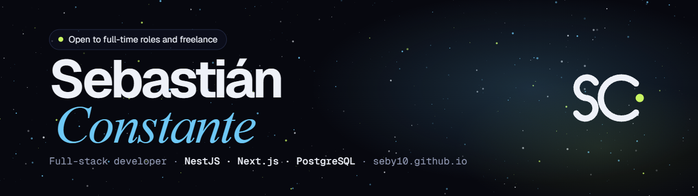

# Sebastián Constante

[English](https://github.com/seby10/seby10#readme) · **Español**

Desarrollador full stack en Ambato, Ecuador. Construyo aplicaciones web con NestJS, Next.js y PostgreSQL, y les sumo IA cuando el problema lo pide.

**Ahora:** pasante de TIC en la Empresa Eléctrica Ambato hasta enero de 2027. Disponible para empleo y proyectos freelance.

   

<picture>
  <source media="(prefers-color-scheme: dark)" srcset="https://skillicons.dev/icons?i=ts%2Cnextjs%2Cnestjs%2Creact%2Cangular%2Cpostgres%2Cspring%2Cjava%2Cpython%2Cdocker%2Cgit&amp;theme=dark">
  
</picture>

## Proyectos

| Proyecto | Qué resuelve | Con qué |
|---|---|---|
| [Kaphiy](https://github.com/Arkasys-GDP/Kaphiy) | Pedidos por QR para una cafetería, con panel de cocina en tiempo real y asistente con IA | NestJS, Next.js, PostgreSQL, Socket.IO |
| [Simulador financiero](https://github.com/seby10/simulador-financiero) | Simulación de créditos e inversiones para una cooperativa, con solicitud en línea | NestJS, Next.js, Prisma, PostgreSQL |
| [Gas-System](https://github.com/Application-Distributed-Gasoline-System/Frontend) | Gestión de una flota sobre microservicios; hice el frontend | Next.js, NestJS, gRPC, NATS, Docker |
| [FERIAUTO, roles de pago](https://github.com/seby10/roles-pago-ec) | Nómina ecuatoriana con IESS, impuesto a la renta y costo del empleador, para el proyecto integrador | Python, Flask, SQLite |
| [Sonar Message](https://github.com/seby10/sonar-message) | Chat en tiempo real con videollamada, analizado con SonarQube | Node.js, Express, WebRTC |

Los casos completos, con mi parte en cada proyecto, están en el [portafolio](https://seby10.github.io).

## Cómo trabajo

- Escribo la especificación antes de construir.
- Trabajo con agentes de programación y les dejo el contexto del proyecto por escrito.
- Pruebas unitarias, de integración y de extremo a extremo donde el proyecto lo pide.

**Uso a diario:** TypeScript, Next.js, NestJS, PostgreSQL, Angular, Spring Boot, Java, Oracle, Git.
**Ahora aprendo:** Google Cloud Computing Foundations y hacking ético.
**Certificados:** Python Essentials 2 y Data Science Essentials with Python (Cisco).

## En números

<picture>
  <source media="(prefers-color-scheme: dark)" srcset="https://github-readme-stats.vercel.app/api?username=seby10&amp;show_icons=true&amp;hide_border=true&amp;hide_rank=true&amp;hide=stars&amp;locale=es&amp;card_width=430&amp;custom_title=Actividad%20en%20GitHub&amp;bg_color=0d1117&amp;title_color=6ec8f5&amp;text_color=eef1f8&amp;icon_color=c9f562">
  
</picture>
<picture>
  <source media="(prefers-color-scheme: dark)" srcset="https://github-readme-stats.vercel.app/api/top-langs/?username=seby10&amp;layout=compact&amp;hide_border=true&amp;langs_count=6&amp;hide=html%2Ccss&amp;locale=es&amp;card_width=380&amp;custom_title=Lenguajes%20m%C3%A1s%20usados&amp;bg_color=0d1117&amp;title_color=6ec8f5&amp;text_color=eef1f8">
  
</picture>

<picture>
  <source media="(prefers-color-scheme: dark)" srcset="https://github-readme-activity-graph.vercel.app/graph?username=seby10&amp;hide_border=true&amp;area=true&amp;bg_color=0d1117&amp;color=eef1f8&amp;line=6ec8f5&amp;point=c9f562&amp;area_color=6ec8f5&amp;title_color=6ec8f5&amp;custom_title=Contribuciones%20del%20%C3%BAltimo%20mes">
  
</picture>
