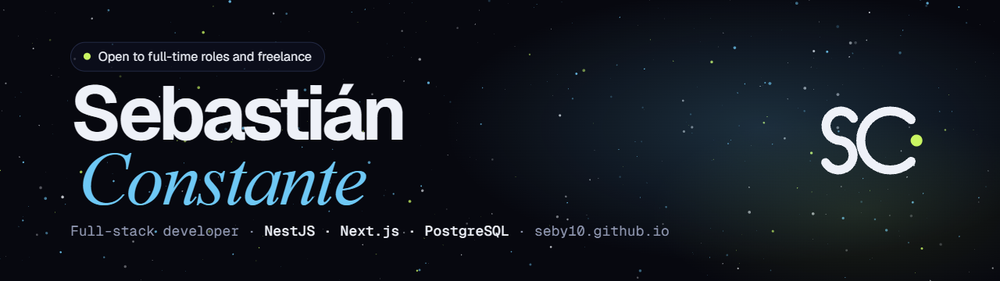

# Sebastián Constante

**English** · [Español](https://github.com/seby10/seby10/blob/main/README.es.md)

Full-stack developer in Ambato, Ecuador. I build web apps with NestJS, Next.js and PostgreSQL, and add AI when the problem calls for it.

**Now:** IT intern at Empresa Eléctrica Ambato, the regional power utility, until January 2027. Open to full-time roles and freelance projects.

   

<picture>
  <source media="(prefers-color-scheme: dark)" srcset="https://skillicons.dev/icons?i=ts%2Cnextjs%2Cnestjs%2Creact%2Cangular%2Cpostgres%2Cspring%2Cjava%2Cpython%2Cdocker%2Cgit&amp;theme=dark">
  
</picture>

## Projects

| Project | What it does | Built with |
|---|---|---|
| [Kaphiy](https://github.com/Arkasys-GDP/Kaphiy) | QR ordering for a coffee shop, with a real-time kitchen dashboard and an AI assistant | NestJS, Next.js, PostgreSQL, Socket.IO |
| [Financial simulator](https://github.com/seby10/simulador-financiero) | Loan and investment simulation for a credit union, with online applications | NestJS, Next.js, Prisma, PostgreSQL |
| [Gas-System](https://github.com/Application-Distributed-Gasoline-System/Frontend) | Fleet management on microservices; I built the frontend | Next.js, NestJS, gRPC, NATS, Docker |
| [FERIAUTO, payroll](https://github.com/seby10/roles-pago-ec) | Ecuadorian payroll with social security, income tax and employer cost, for the semester's integration project | Python, Flask, SQLite |
| [Sonar Message](https://github.com/seby10/sonar-message) | Real-time chat with video calls, analyzed with SonarQube | Node.js, Express, WebRTC |

Full case studies, including my part in each project, are on my [portfolio](https://seby10.github.io/en/), in English and Spanish.

## How I work

- I write the spec before I build.
- I work with coding agents and give them the project context in writing.
- Unit, integration and end-to-end tests where the project calls for them.

**Daily:** TypeScript, Next.js, NestJS, PostgreSQL, Angular, Spring Boot, Java, Oracle, Git.
**Learning now:** Google Cloud Computing Foundations and ethical hacking.
**Certificates:** Python Essentials 2 and Data Science Essentials with Python (Cisco).

## By the numbers

<picture>
  <source media="(prefers-color-scheme: dark)" srcset="https://github-readme-stats.vercel.app/api?username=seby10&amp;show_icons=true&amp;hide_border=true&amp;hide_rank=true&amp;hide=stars&amp;card_width=380&amp;custom_title=GitHub%20activity&amp;bg_color=0d1117&amp;title_color=6ec8f5&amp;text_color=eef1f8&amp;icon_color=c9f562">
  
</picture>
<picture>
  <source media="(prefers-color-scheme: dark)" srcset="https://github-readme-stats.vercel.app/api/top-langs/?username=seby10&amp;layout=compact&amp;hide_border=true&amp;langs_count=6&amp;hide=html%2Ccss&amp;card_width=380&amp;custom_title=Most%20used%20languages&amp;bg_color=0d1117&amp;title_color=6ec8f5&amp;text_color=eef1f8">
  
</picture>

<picture>
  <source media="(prefers-color-scheme: dark)" srcset="https://github-readme-activity-graph.vercel.app/graph?username=seby10&amp;hide_border=true&amp;area=true&amp;bg_color=0d1117&amp;color=eef1f8&amp;line=6ec8f5&amp;point=c9f562&amp;area_color=6ec8f5&amp;title_color=6ec8f5&amp;custom_title=Contributions%20in%20the%20last%20month">
  
</picture>
